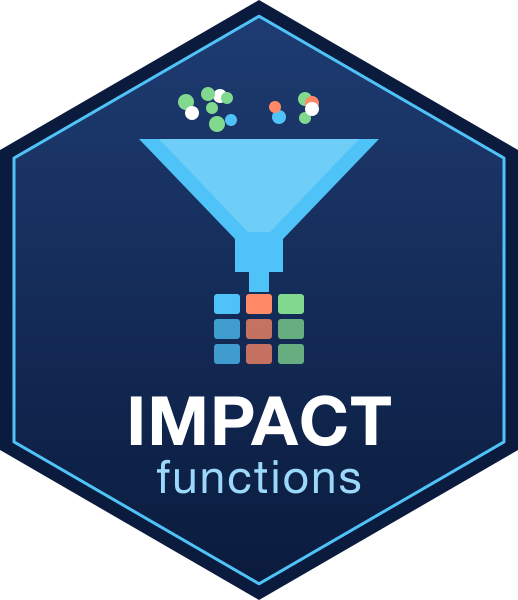

# IMPACTfunctions 

<!-- badges: start -->
[](https://lifecycle.r-lib.org/articles/stages.html#experimental)
[](https://github.com/SAFEHR-data/IMPACTfunctions/actions/workflows/R-CMD-check.yaml)
[](https://opensource.org/licenses/MIT)

<!-- badges: end -->

IMPACTfunctions is an R package to work with the IMPACT peri-operative dataset. It streamlines the process of building study datasets with cohorting, filtering and feature extraction functions. Functions are clinically validated with sensible warnings (*eg warn if you try to sum doses with different units*). Function defaults and explicitly reference and dictionaries ensure analysis is consistent between users and datasets. 

> **UNDER DEVELOPMENT** This pacakge is under active developement. Features and functions may be updated and changed without warning and there is no promise of backward compatability. Describing issues and bugs is very helpful and part of our collobarative proccess to validate the pacakge and the dataset!

## Installation

You can install the development version of IMPACTfunctions from [GitHub](https://github.com/) with:

```{r eval=FALSE}

# Install package from github:
remotes::install_github("SAFEHR-data/IMPACTfunctions", force=TRUE,
                        auth_token = gitcreds::gitcreds_get()$password)

```

> 🔒 **Private repo** The current development version of the package is private. You will require a github PAT to the repo. Follow [this guide](https://uclh.slab.com/posts/git-hub-integration-6s9bw63t) to get one (internal SLAB wiki, UCLH network only).


> 🔒 **On UCLH RStudio Server?** The UCLH network proxy can block the download above. See [Installing packages from GitHub on RStudio Server](https://uclh.slab.com/posts/installing-packages-from-git-hub-on-r-studio-server-b9mpm526) (internal SLAB wiki, UCLH network only) for the extra proxy code needed.


## Functionality and dependancy

| Feature | Functions | Documentation and vignette | Synthetic data | Unit test | Clinically validated |
|--------------|-------------------|--------------|---------|---------|---------|
| Subsetting by surgical procedure | `cohort_procedure_coded()` | ✔️ and ✔️ | ✔️ | ❌ | 🔄 in progress |
| Medication administrations | `search_drug_names`, `extract_medication()` and `calculate_medication_feature()` | ✔️ and ✔️ | ✔️ | ❌ |  |
| PCA data | `pca_clean_data()` and `pca_hourly_administration()`  | ✔️ and 🔜 (drafted, need synth data) | ❌ | ❌ |  |
| Flowsheet data (pain, obs, etc...) | `search_flowsheet_name()`, `extract_flowsheet_data()` and `calculate_flowsheet_feature()` | ✔️ and 🔜 (Drafted in Med admin section) | ✔️ | ❌ |  |

: Features in Package version: `r desc::desc_get_version()` | Package compatible with IMPACT dataset up to `20260624`


### Future features

The dataset also contains the following datapoints:

- Blood transfusion administration data
- Dispensed medication to establish the discharge medications
- Medication prescriptions to understand the prescribing intention behind meds administration
- Imaging including the scan type, date and reports and radiologist
- Bloods including pre-admission/pre-assessment bloods 
- Lines, drains and airways with LDA details, in/out times and flow/volumes 
- Observations - Similar to measurements but what is observed. 
- The anaesthetic and operating room timepoints 
- Operation notes as free text
- List of the members of staff involved in each case
- Patient movements though the hospital with their bedspace at each timepoint. 


## FAQ and error troubleshooting

See the [FAQ page](https://impactfunctions.dylanwhitaker.co.uk/articles/FAQ.html) (or the [source](https://github.com/SAFEHR-data/IMPACTfunctions)) for tips on the troubleshooting and explaining common errors. Leave a github issue with any more complex issues.

## Contributing

We welcome the help to contribute, see the [SLAB article](https://uclh.slab.com/posts/how-to-contribute-to-an-r-package-kkfuh997?shr=a5jb3q7t0av7r0z9e22b36l5) on how to add functions.

## Example

This is a basic example which shows you how to solve a common problem:

```{r eval=FALSE}
library(arrow)
library(cli)
library(dplyr)
library(IMPACTfunctions)

impact <- load_dataset(folder_path = "~/data/dwhitake/data/IMPACT/20260122",
             prefix = "SCB_Periop_",
             suffix ="_20260122.parquet",
             verbose = TRUE)

# Tables are available through the returned object ...
impact$Demographics %>% glimpse()

# ... and, unless you pass `attach = FALSE`, by name
Demographics %>% glimpse()
```

# Acknowledgments

Package written using the [R packages book](https://r-pkgs.org/preface.html)
