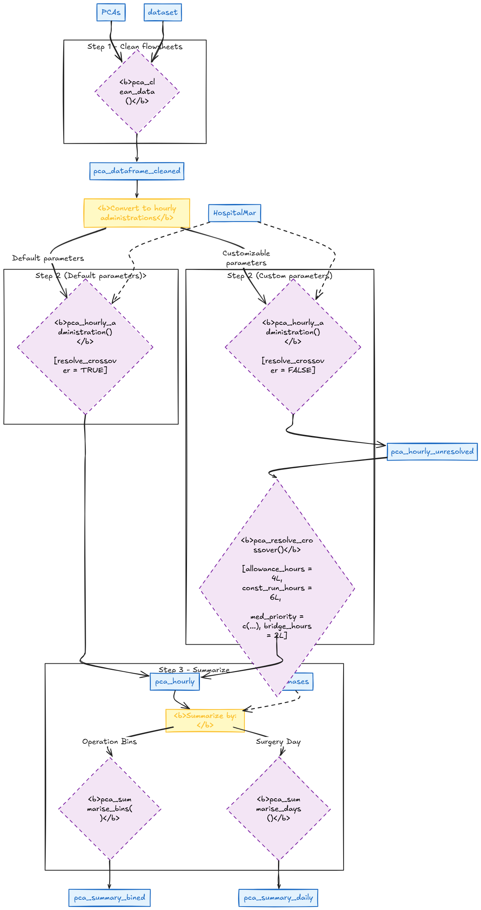

```{r, include = FALSE}
knitr::opts_chunk$set(
  collapse = TRUE,
  comment = "#>",
  eval = FALSE # Don't evalute the code blocks below as we do not have PCA data synthetic
)
```

```{r echo=FALSE, eval=TRUE, message=FALSE}
# Instead of librarying the package, we actually want to dynamically load_all
library(IMPACTfunctions)
library(arrow)
library(dplyr)
```

```{r eval=TRUE, message=FALSE, echo=FALSE}
#If you do not have a real dataset, load the synthetic dataset
synth_data <- load_synthetic_dataset()
list2env(synth_data, envir = .GlobalEnv)
rm(synth_data)
```

```{r setup, eval=TRUE, echo=TRUE}
library(IMPACTfunctions)
library(arrow)
library(dplyr)
```

```{r cohort generation}
#| echo: true
#| output: false

c1 <- cohort_procedure_codes(Procedures,
             cohort_name = "Hip, replacement",
             include_OPCS = c("W37", "W38", "W39"),
             exclude_OPCS = c("W40", "W41", "W42"))


c1 <- collect(c1) %>% mutate(cohort = "Hip replacement")

c2 <- cohort_procedure_codes(Procedures,
             cohort_name = "Knee replacement",
             include_OPCS = c("W40", "W41", "W42"),
             exclude_OPCS = c("W37", "W38", "W39"))

c2 <- collect(c2) %>% mutate(cohort = "Knee replacement")

df <- rbind(c1, c2)

```

> NOTE: The PCA synthetic data is not avalible at presnet. The code blocks below do not run so produce no results. This code should work with a real dataset. 


# How to use PCA (Patient Controlled Analgesia) functions. 

PCA data is complicated. It is a medication that is marked as adminisrted on the MAR however the useage is tracked on flowsheets. 
A PCA can be set up in Bolus mode (gives a dose when button is pressed) or is Infusion (gives a constant rate) or both. 
There is significant challanges to collate the perscription, MAR and flowsheet data to understand how much PCA a patietn has recived within the IMPACT dataset. 

James Bedford has written an impressed and detailed set of functions to proccess and analyse this data. They are laid out below.


# Summary

Below is a diagram that helps to explain the flow of data though the various functions.



The initial phase ingest raw flowsheet inputs and clinical datasets to enforce structural integrity. The `pca_clean_data()` function parses structural metadata, removes duplicate charting artifacts, normalises clinical timestamps, and filters extraneous rows to isolate valid PCA events.

### Step 1: Data cleaning

```{r}
# Synthesise a clean operational dataframe from raw PCA registries and EHR datasets
pca_dataframe_cleaned <- pca_clean_data(
  PCA_dataframe = PCAs,
  dataset = df
)

```

---

## Step 2: Hourly Administration Conversion and Crossover Resolution

Once cleaned, longitudinal flowsheet data must be mapped to discrete, continuous hourly intervals to compute precise administration vectors. A major challenge during this step is clinical crossover—instances where concurrent or conflicting medication administration records (MAR) threaten the mathematical validity of hourly dose attributions.

We present two alternative approaches to handle this conversion depending on whether you choose to use immediate automated heuristics or delayed, fine-grained deterministic parameters.

### Option A: Default parameters

This approach converts the data and applies standard operational heuristics inline to resolve medication conflicts natively within a single step.

```{r}
# Convert flowsheet data directly into hourly intervals with automated crossover correction
pca_hourly <- pca_hourly_administration(
  pca_dataframe_cleaned  = pca_dataframe_cleaned,
  mar_df = HospitalMar,
  resolve_crossover = TRUE,
  verbose = TRUE
)

```

### Option B: Providing parameters for resolution

User may wish to change the default parameters used in `pca_resolve_crossover()`. To do this, run the `pca_hourly_administration()` with  `resolve_crossover = FALSE`. Then run `pca_resolve_crossover()` and provide the parameters as needed. Refer to the help to understand the action of each. 

```{r}
# 1. Generate the continuous hourly data matrix leaving crossovers unresolved
pca_hourly_unresolved <- pca_hourly_administration(
  pca_dataframe_cleaned  = pca_dataframe_cleaned,
  mar_df = HospitalMar,
  resolve_crossover = FALSE,
  verbose = TRUE
)

# 2. Apply granular domain-specific rules to resolve medication overlaps
pca_hourly <- pca_resolve_crossover(
  pca_hourly = pca_hourly_unresolved,
  allowance_hours = 4L,
  const_run_hours = 6L,
  med_priority = c("Oxycodone", "Fentanyl", "Morphine"),
  bridge_hours = 2L,
  drop_on_equal_allowance = FALSE,
  drop_within_allowance = FALSE
)

```

---

## Step 3: Summarisation and Feature Aggregation

The final step aggregates the granular hourly administration matrix into buckets suitable for endpoints. These can be returned as either bins from the end of surgery or bins from post-operative days (where POD 0 is the day of surgery and POD 1 starts at 8am the following day)

### Option A: Post-Operative Binning

This method bins administration data relative to an anchoring post-operative timestamps.

```{r}
# Summarise cumulative administration into custom-defined physiological/clinical phases
pca_summary_bined <- pca_summarise_bins(
  pca_hourly = pca_hourly,
  phases = Phases
)

```

### Option B: Daily binning

Alternatively, data can be aggregated into daily surgical intervals calculated from a standardised clinical shift timeframe (e.g., 08:00 onwards).

```{r}
# Summarise total opioid consumption aggregated by surgical recovery days
pca_summary_daily <- pca_summarise_days(
  pca_hourly = pca_hourly,
  phases = Phases,
  output = "dose"
)

```


